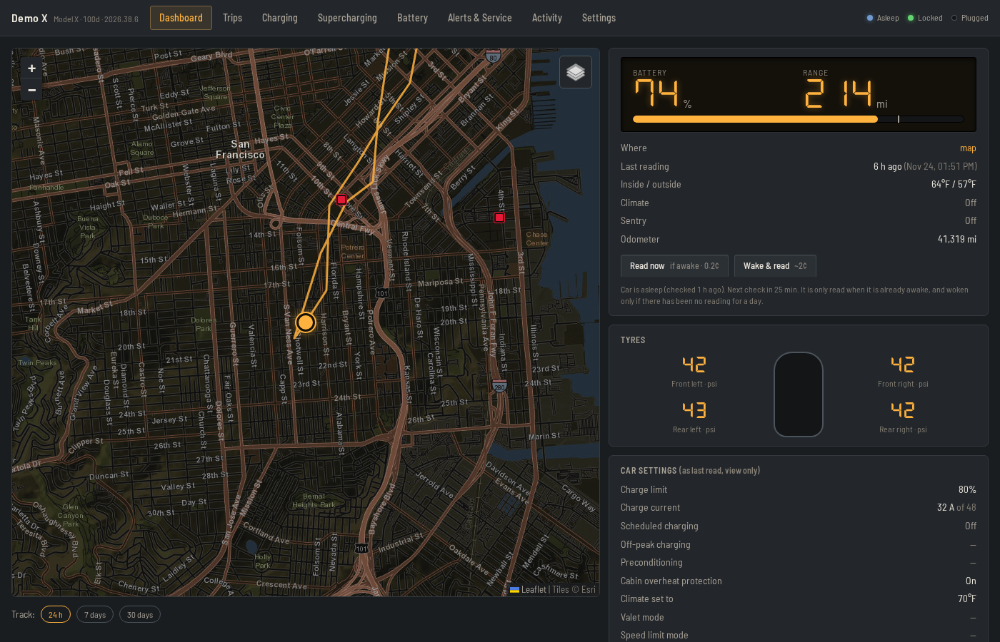
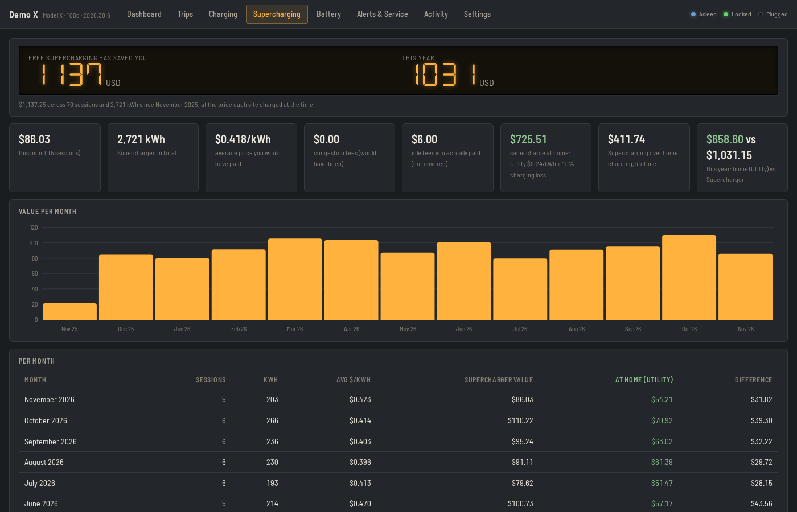
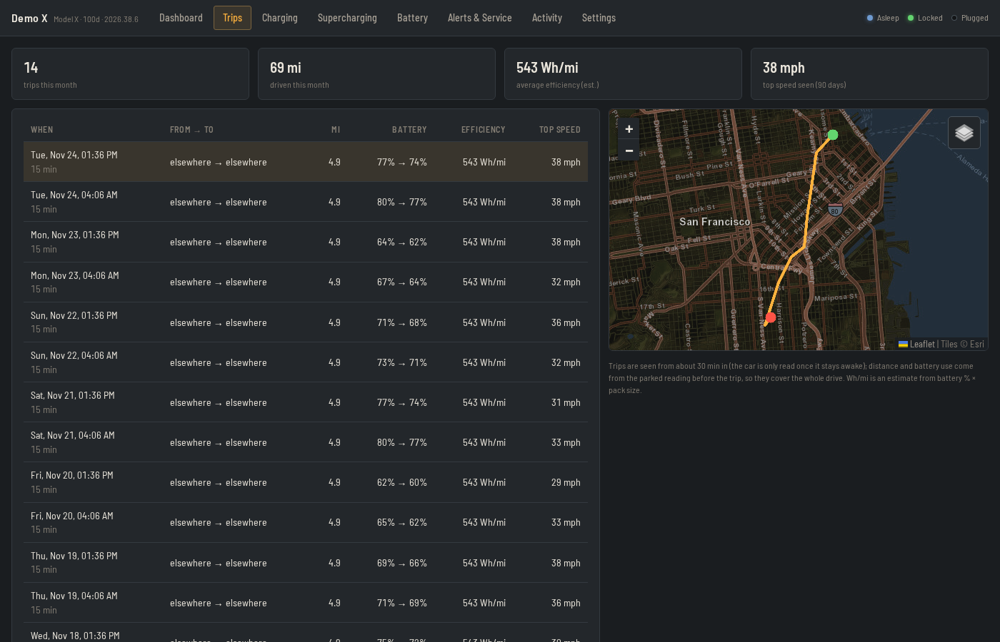
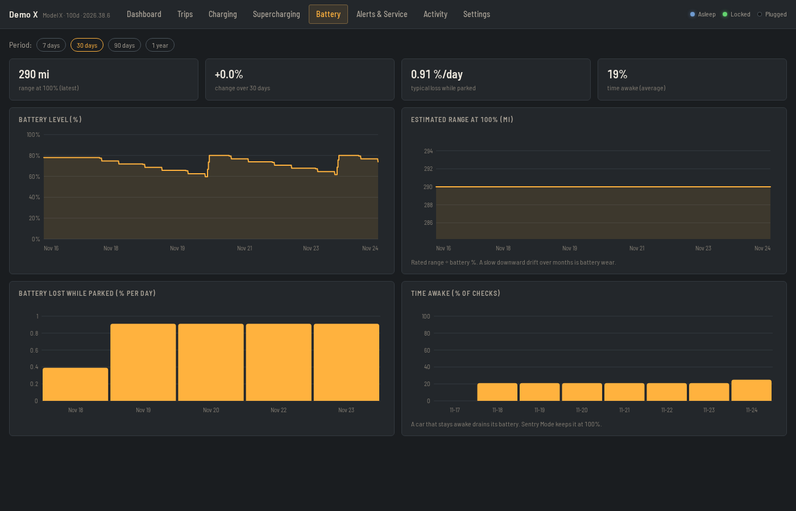
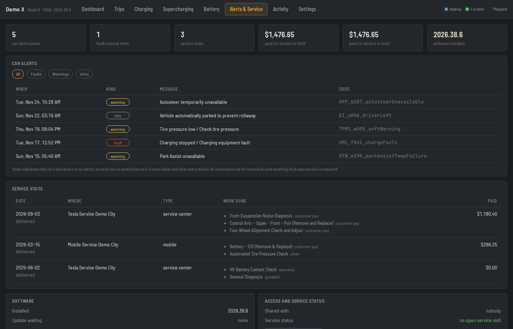

# tesla-tools

A self-hosted dashboard for one Tesla that **never keeps the car awake** and **stays inside Tesla's
free $10/month API credit**. It records history the Tesla app doesn't keep (trips, charging,
battery drain, time awake), works out what your Supercharging is worth, and emails you when
something needs attention.



*Screenshots use made-up demo data (`python3 tools/demo.py`).*

## What it does

- **Dashboard.** The car on a map with its track over the last 24 h, 7 or 30 days (street, dark or
  satellite maps). Battery and range readouts, the charge limit, tyre pressures, temperatures,
  locks and openings, the car's own settings (view only), and nearby Superchargers with free
  stalls (fetched only while the car is awake anyway).
- **Trips.** Each drive with from → to, distance, battery used, an efficiency estimate (Wh/mi) and
  top speed. Click one to see its route.
- **Charging.** Every charge longer than about half an hour: when, where, battery before → after,
  kWh added, peak and average kW, volts and amps, AC vs Supercharger.
- **Supercharging savings.** Reads Tesla's own Supercharger history, which records each site's real
  price per kWh at that time even when you paid nothing (free unlimited Supercharging, credits).
  Shows what every session would have cost, with congestion fees, idle fees you actually paid, and
  totals per month, year and site. It also compares each session with the same energy charged at
  home on your electricity rate, including charging losses.
- **Battery.** Battery level over time, estimated range at 100% (a slow downward drift is battery
  wear), battery lost per day while parked, and how much of each day the car was awake.
- **Alerts & Service.** The car's own alerts ("Autosteer unavailable", "Service is required", with
  Tesla's internal code), kept permanently: Tesla only holds the last dozen. Every service visit
  with the work done, who paid (you, warranty, goodwill) and the total, plus the installed and
  waiting software, the release notes, and who the car is shared with.
- **Activity.** Readings, wakes, button presses, alerts and settings changes in one feed.
- **Email alerts.** Parked and unlocked, a low or uneven tyre, low battery and unplugged in the
  evening, a new car fault or "service required" alert, the monthly budget reached, or the poller
  failing for an hour.
- **Prometheus metrics** at `/metrics`, plus an example Grafana dashboard in `grafana/`.

| | |
|---|---|
|  |  |
|  |  |

## How it avoids waking the car

A parked Tesla goes to sleep after a quiet spell; anything that talks to it resets that clock and
costs battery. So:

- The routine check (every 30 minutes by default) asks **Tesla's servers** whether the car is
  asleep. That request never reaches the car.
- The car itself is only read once it has been awake for **two checks in a row**: it is
  driving, charging or in Sentry Mode anyway. A brief self-wake is left alone.
- While driving it reads every 2 minutes, every 10 while charging, and goes quiet once parked.
- The only time it wakes the car is if there has been **no reading for 24 hours** (configurable,
  0 = never): one wake, one read, then silence. A failed wake is not retried until the next day.
- There is a **Read now** button (only if the car is already awake) and a **Wake & read** button
  (asks first).

The trade-off: a drive shorter than about 30 minutes may not be recorded, and longer ones show up
part-way through. The reading taken before a drive still gives the true start, distance and
battery used.

## Cost

Tesla charges per request (500 data requests or 50 wakes per $1) and gives each developer
account a **$10 monthly credit**. tesla-tools counts every request at those list prices and stops
for the rest of the month at a cap you set (default **$8**), paced day by day so it can't spend the
whole budget early. A car that mostly sleeps costs about $3–4 a month in background checks, plus
about 30¢ for the daily alerts, service, software and Supercharger-history syncs. The
spend shown on the page is this estimate; your real bill is on Tesla's developer dashboard.
Setting a small billing limit there as well is a good backstop.

## Requirements

- Python 3.11 or newer. No other packages: everything is in the standard library.
- A Linux box that stays on (any OS with Python works; the service file is for systemd).
- A Tesla account and a [Tesla developer](https://developer.tesla.com) app.
- Somewhere to host one public file over HTTPS on a domain you control. A free GitHub Pages site
  works.

## Setup

1. **Create a developer app** at developer.tesla.com. Use:
   - Allowed Origin URL: `https://<you>.github.io` (or your domain)
   - Allowed Redirect URI: `http://localhost:8080/callback`
   - Scopes: vehicle information, location, commands and charging management. The app only reads
     data and, at most once a day, wakes the car; it sends no other commands.

   Add a payment method and a small billing limit, or Tesla disables the app.

2. **Make a key pair and publish the public half:**
   ```sh
   install -d -m 700 ~/.config/tesla && cd ~/.config/tesla
   openssl ecparam -name prime256v1 -genkey -noout -out private-key.pem
   openssl ec -in private-key.pem -pubout -out public-key.pem
   ```
   Serve `public-key.pem` at
   `https://<you>.github.io/.well-known/appspecific/com.tesla.3p.public-key.pem`. On GitHub
   Pages, add an empty `.nojekyll` file or the `.well-known` folder is skipped.

3. **Save your app's credentials** (never paste the secret into chats or tickets):
   ```sh
   echo '<client id>' > ~/.config/tesla/client_id
   nano ~/.config/tesla/client_secret && chmod 600 ~/.config/tesla/client_secret
   ```

4. **Configure:** copy `config.example.toml` to `~/.config/tesla/config.toml` and set at least
   `domain` and `region`.

5. **Register your domain with Tesla:** `python3 register_partner.py`.

6. **Log in once:**
   ```sh
   python3 login.py url
   ```
   Open the link, sign in with your Tesla account and approve. The browser then lands on a page
   that doesn't load; that's expected. Copy its whole address and run:
   ```sh
   python3 login.py exchange '<the address>'
   ```
   Tokens are saved to `~/.config/tesla/tokens.json` and renew themselves.

7. **Run it:**
   ```sh
   cp deploy/tesla-poller.service ~/.config/systemd/user/
   systemctl --user daemon-reload && systemctl --user enable --now tesla-poller
   ```
   Open `http://<this machine>:9877/`.

## Access and security

- On your home network (and Tailscale) the page opens without a password, like most LAN
  dashboards.
- From anywhere else it needs its **own password**, which can only be set on the Settings tab from
  home. With no password set, outside access is refused.
- Behind a reverse proxy, pass the visitor's address in `X-Forwarded-For` from `127.0.0.1`; it is
  only trusted from there. Requests that change anything need an `X-Requested-With: tesla`
  header, which other sites can't send.
- It never sends a car command except wake-up.

## Try it without a car

```sh
python3 tools/demo.py
```

opens the page on made-up data at `http://127.0.0.1:9878/`. It uses a temporary folder and never
contacts Tesla.

## Files

| | |
|---|---|
| `tesla_service.py` | the poller: schedule, budget, alerts, metrics, the HTTP server |
| `webapp.py` | the web page's API and access rules |
| `analysis.py`, `charging.py`, `supercharger.py` | trips, battery, charging and Supercharger maths |
| `extras.py` | car alerts, service visits, software, drivers, nearby Superchargers |
| `web/` | the page (plain HTML/CSS/JS, Leaflet bundled) |
| `login.py`, `register_partner.py` | one-off setup |
| `config.py`, `config.example.toml` | install settings |
| `tools/demo.py` | demo mode |
| `grafana/tesla.json` | example Grafana dashboard for the `/metrics` data |

## Not affiliated with Tesla

This is an independent project using Tesla's public Fleet API. Tesla is a trademark of Tesla, Inc.

## Licence

MIT. Bundled fonts and Leaflet keep their own licences; see [THIRD_PARTY.md](THIRD_PARTY.md).
